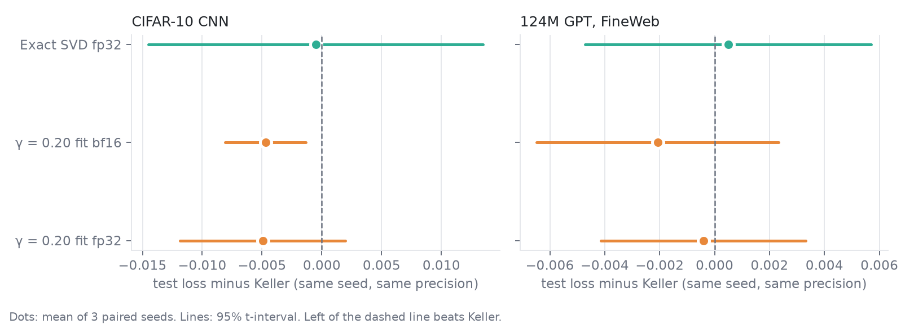
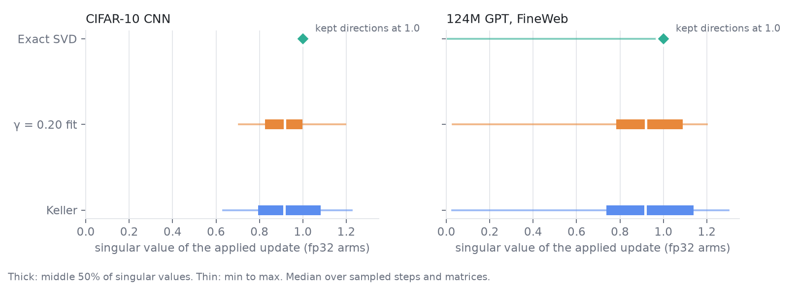
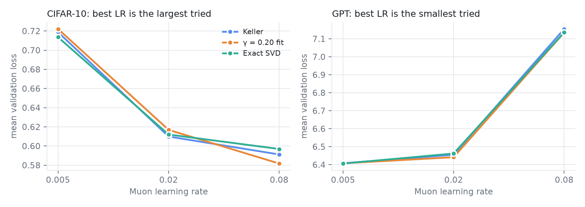

# nsshape: does Muon work because of *how well* it orthogonalizes, or *what shape* it leaves behind?

Muon replaces each gradient matrix with something close to its polar factor
(all singular values pushed to 1) using five steps of a Newton–Schulz quintic.
Except the standard quintic, Keller Jordan's, was tuned for speed, not
accuracy. It never actually reaches the polar factor. It squashes singular
values into a band of roughly 0.7 to 1.3 and calls it a day.

So which part matters? **H1:** the band shape is what does the work, and a
deliberately shaped band could train better than either Keller's quintic or the
exact polar factor.

To test that, I built a one-parameter family of quintics where γ sets the band
width, certified each one (bounded, positive, actually hits its band), dropped
them into an instrumented Muon, and ran a budget-matched study on two RTX 3090s:
a CIFAR-10 CNN sweep to pick the best γ and learning rates, then fresh-seed
confirmation on CIFAR-10 and a ~124M GPT trained on FineWeb.

## Results

**Short version: shape helps a little on CIFAR, does nothing measurable on the
language model, and exact orthogonalization buys nothing for 12× the cost.**
H1 is not supported, but it is not ruled out either.

The CIFAR sweep (21 arm/precision pairs × 3 learning rates × 2 seeds, 126 runs)
picked **γ = 0.20**, a slightly *tighter* band than Keller's (γ ≈ 0.30).
Confirmed on 3 fresh seeds per arm, paired by seed:



| | γ = 0.20 vs Keller | Exact SVD vs Keller | Seconds per run (fp32) |
|---|---|---|---|
| CIFAR-10, bf16 | **−0.0047** [−0.0081, −0.0013] | — | 14.3 |
| CIFAR-10, fp32 | −0.0049 [−0.0119, +0.0020] | −0.0005 [−0.0145, +0.0135] | 14.3 vs 28.4 |
| GPT, bf16 | −0.0021 [−0.0065, +0.0023] | — | 346 |
| GPT, fp32 | −0.0004 [−0.0041, +0.0033] | +0.0005 [−0.0047, +0.0057] | 657 vs 8,109 |

Test cross-entropy differences, mean and 95% t-interval over 3 paired seeds.
Negative favors the arm.

- **CIFAR-10:** the γ = 0.20 fit beats Keller in bf16, and its interval stays
  below zero. That's about 0.1 points of accuracy (79.4% vs 79.3%), so it's real
  but small. In fp32 the gap is the same size, but the interval crosses zero.
- **Language:** every arm ends at 5.47 test loss and 20.4% next-token accuracy.
  Nothing resolves. The budget was 3,082 steps × 2,048 tokens ≈ **6.3M tokens
  per run**, which is very early training, nowhere near the 2–5B tokens where
  Muon is usually judged.
- **Exact SVD** matches Keller everywhere at **12× the wall clock** on the GPT
  (8,109 s vs 657 s). Accuracy of the polar approximation, past what Keller
  already gives, didn't buy anything here.

### What the polynomial actually did to the spectrum

The certificates are scalar statements about singular values in [σ_min, 1]. The
logger records what the *applied update* really looked like during training:



γ = 0.20 does what it was fit to do. Its band is tighter at the top (max 1.20
vs Keller's 1.30) and its middle 50% is narrower. But in the GPT, about **20%
of each update's singular values sit below σ_min** for both arms, so the
polynomial never pulls them into the band (the thin lines reaching toward 0).
On CIFAR that's about 7%. So the "shape" only governs part of the spectrum
these models produce, which is one plausible reason the language model can't
tell the arms apart.

### Things that went wrong, and what they mean for the result

- **The learning-rate grid was too narrow.** Every CIFAR arm picked the largest
  rate tried (0.08) and every GPT arm picked the smallest (0.005). The true
  optimum is likely outside the grid, so these comparisons are at a rate that is
  equally off for every arm, not at each arm's best.
  
- **Wide bands diverge in bf16.** Three CIFAR tuning runs hit non-finite
  gradients or loss: γ = 0.45 at two rates and γ = 0.60 at one, all in bf16, and
  never in fp32. The first time this happened it crashed the whole study an hour
  in. Now a diverged tuning run is recorded, its learning rate is barred from
  selection, and the run is listed in the report (`8c10778`, `83d5f73`).
  Divergence in confirmation still stops the study.
- **3 seeds is low power.** The intervals are descriptive and not corrected for
  multiple comparisons.

Everything here traces back to files in the repo:
[`reports/dual3090/results.md`](reports/dual3090/results.md) is generated by the
study, [`reports/dual3090/summary.json`](reports/dual3090/summary.json) holds
the tuning grid, curves, spectra and cost, and
[`reports/audit.md`](reports/audit.md) is the audit of the stage 1–2 code that
came before any training. The full run (checkpoints and per-step spectra) is
17 GB and not committed. 5.8 h of the 8 h budget, peak 3.1 GB per GPU.

### Next

Widen the LR grid (at least 0.0025–0.16), run the GPT 10–50× longer, and add a
γ sweep on the language model directly rather than inheriting the CIFAR winner.
The spectra suggest an extra idea too: rescale before iterating so fewer
singular values fall below σ_min, then check whether shape starts to matter.

## The γ family

One-parameter family of odd quintics `P(x) = ax + bx³ + cx⁵`, composed **N = 5**
times so every member is exactly compute-matched. For each γ:

```
minimize    σ_min
over        a, b, c
subject to  relhw( C([σ_min, 1]) ) ≤ γ            (band)
            reachable_bound(P) < ∞                 (bounded iteration)
            P(x) > 0  on (0, B]                    (positivity)

where       relhw(S) = (max S − min S) / (max S + min S)
            C = P∘P∘P∘P∘P
```

γ is the band half-width; σ_min is the smallest input singular value the map
still pulls into the band. A wider band buys the ability to lift near-zero
singular values within a fixed step budget — that is the real tradeoff Muon
makes, and the axis this ablation sweeps.

## Three constraints that are load-bearing

Each of these looks like an unnecessary complication until you hit the failure it
prevents. All three were established empirically; the naive version fails.

**The band is relative, not absolute.** A polynomial emitting every singular
value at 0.7 is the *same optimizer* as one emitting 1.0 with a 1.43× smaller
learning rate — the scale is absorbed by η. Using absolute deviation from 1
confounds γ with η and turns the 2D sweep into a diagonal. Relative half-width is
scale-invariant by construction. Each entry stores the band center as `scale`,
applied as a divisor at use time.

**Boundedness is a reachable-set fixed point.** The constraint is that iterating
`B ← max(1, sup_[0,B] P)` from `B = 1` converges. Tempting alternatives reject
Muon itself: `sup_[0,1+γ] P ≤ 1+γ` gives B = 1.3 for Keller while P(1.3) = 1.53,
so it self-rejects — yet Keller's actual reachable set is bounded at 1.2024 and
it is a working optimizer. Any constraint that excludes Keller is the wrong
constraint. The fixed point is also γ-independent, which is correct: boundedness
has nothing to do with band width.

**Positivity, not monotonicity.** Keller's quintic is monotone only up to
x\* = 0.5545; the committed fitted members have x\* ≈ 0.393–0.644. The
non-monotonicity is essential — it is how the polynomial squashes large singular
values back down. Requiring monotonicity on [0,1] excludes the entire useful
family. `P′ > 0 on [0, x*]` is vacuous, being the definition of x\*. What
actually binds is positivity on (0, B]; x\* is recorded as a diagnostic.

## What the table shows

Nine fitted entries span γ ∈ [0.01, 0.60] — hyper-accurate polar through standard
Muon to deliberately distorted — plus the `keller` baseline and an `exact_svd`
sentinel. The frontier is strictly monotone: tighter bands cover less input
range.

Keller's quintic sits **inside** the frontier at its own achieved band γ ≈ 0.30,
reaching σ_min = 1.42e−3 against a fitted optimum of 9.04e−4. So standard Muon is
a genuine interior member of the family with roughly 57% headroom in dynamic
range — which is exactly the slack H1 predicts might be exploitable.

Note that `exact_svd` is not a γ → 0 limit of the polynomials but a separate
backend with a different measured cost. Its canonical partial polar factor
preserves zero and excludes numerical null-space directions; full-rank spectra
have zero band width.

## A caveat when reading spectra

Muon Frobenius-normalizes before iterating, so for an n×n matrix σ_max lands near
1/√n and the smallest singular values fall *below* the certified σ_min. Real
inputs therefore occupy a compressed sub-range of the certified domain [σ_min, 1].
Band *width* still holds on any subinterval — an image subset can only be
narrower — but the band *center* equals 1 only over the full range. Singular
values below σ_min are not pulled into the band at all, which is precisely what
σ_min certifies. Use controlled spectra, not plain Gaussians, when probing this.

## Install

```bash
uv venv --python 3.12
uv pip install -e ".[dev]"
```

## Use

```python
from nsshape.optim.muon import ParameterizedMuon
from nsshape.diagnostics.svd_logger import SVDLogger

logger = SVDLogger("runs/spectra.jsonl", every_k=50, max_params=4)
opt = ParameterizedMuon(matrix_params, lr=0.02, coeff_set="gamma_0.20", hook=logger)
```

`coeff_set` is any entry name in the table: `gamma_0.01` … `gamma_0.60`,
`keller`, or `exact_svd`. Pass only 2D parameters; embeddings, biases and norms
belong in a separate AdamW group, as in standard Muon.

## Tests

```bash
uv run pytest -m "not slow"   # fast suite, ~2s
uv run pytest                 # includes solver fits, ~2min
```

The table tests avoid the solver. `tests/test_research_integrity.py` additionally
checks continuous image bounds through independently computed polynomial extrema.
Production certificates use analytic interval extrema in float64; input threshold
resolution remains grid-limited. These numerical checks do not prove a globally
optimal frontier or predict training performance.

## Training study on two 3090s

After the installation and dataset-preparation steps in
[the protocol](docs/dual3090-study.md), run:

```bash
bash scripts/launch_dual3090.sh 8 runs/dual3090
```

The launcher calibrates the actual GPUs, runs two independent jobs concurrently,
selects configurations on validation data, confirms on fresh seeds, and generates
`reports/dual3090/results.md`. The approximately 124M GPT confirmation uses a
matched, calibrated token budget and is shorter than the original 2–5B-token
proposal. Installation, data preparation, preflight, and tests precede the timed
training budget.

`ParameterizedMuon(..., precision="fp32")` isolates the intended polynomial
shape; default `precision="bf16"` retains the practical Muon implementation.
The study tests both, because scalar band certificates do not certify bf16
matrix arithmetic. Checkpoints include exact coefficients, precision, and step.
For uniform diagnostic sampling, pass `population_size` and `coefficient_set` to
`SVDLogger`; without a population size it logs the first parameters explicitly.

## Regenerating artifacts

```bash
uv run python scripts/generate_coefficients.py   # rewrites data/coefficients/v1.json
uv run python scripts/plot_composed_maps.py      # writes figures/composed_maps.png
```

The solver is stochastic and restarts across five seeds, keeping the best
feasible result. A single run is not reliable — one seed converged to an
infeasible local optimum at γ = 0.50 while succeeding at 0.40 and 0.60 from
identical settings. If `test_frontier_is_monotone_in_gamma` fails after
regenerating, a γ hit a bad optimum; rerun with more seeds.

## Layout

| Path | Responsibility |
|---|---|
| `src/nsshape/polynomial.py` | Evaluate, compose, analyze quintics. Pure numpy, reference truth. |
| `src/nsshape/solve.py` | Constrained fit γ → coefficients + certificate. scipy. |
| `src/nsshape/coefficients.py` | Load/validate the committed table; resolve entries by name. |
| `src/nsshape/optim/orthogonalize.py` | `ns_quintic` (bf16) and `exact_svd_polar` (fp32) backends. |
| `src/nsshape/optim/muon.py` | `ParameterizedMuon` optimizer. |
| `src/nsshape/diagnostics/` | fp32 SVD spectral logger and record schema. |
| `src/nsshape/experiments/` | CIFAR-10 CNN and GPT training workers driven by a JSON spec. |
| `scripts/run_study.py` | Calibrate, budget, tune, select, confirm on two GPUs; resumable. |
| `scripts/summarize_run.py`, `scripts/plot_study.py` | Compact summary and README figures from a run. |
| `data/coefficients/v1.json` | Generated, committed artifact. |

`polynomial.py` and `solve.py` never import torch; `optim/` and `diagnostics/`
never import scipy. The optimizer takes a coefficient-set *name* and the logger
takes a *hook*, so neither knows what model it is training — which is what lets
the same code drive both cifar10-airbench and modded-nanogpt.

## Design docs

- `docs/superpowers/specs/2026-08-26-ns-polynomial-ablation-design.md`
- `docs/superpowers/plans/2026-08-26-ns-polynomial-shaping.md`
